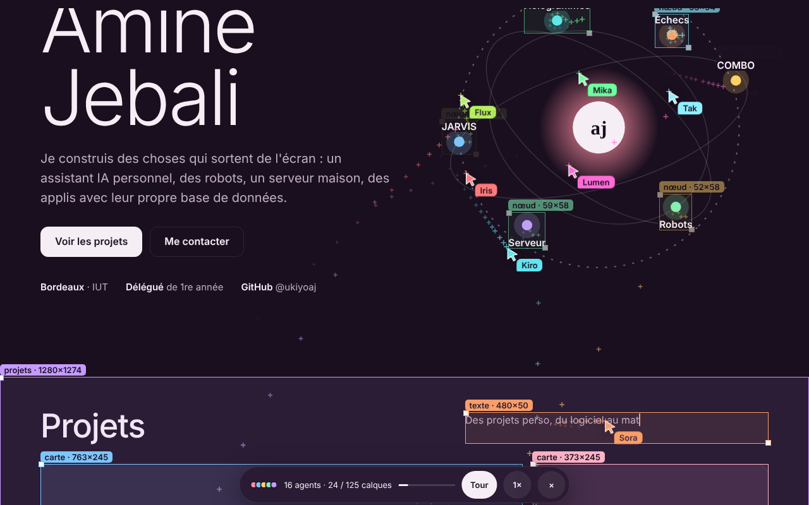

# 🏗️ Chantier en direct

Des **curseurs colorés** construisent ta page web **sous tes yeux**, comme une équipe sur un fichier de design multijoueur.
Chaque curseur sélectionne un élément, tape le texte lettre par lettre, fait apparaître les blocs, puis passe au suivant pendant que la page descend toute seule.


▶️ [Voir la vidéo complète (35 s)](demo.mp4)



**Démo en ligne :** https://ukiyoaj.github.io/chantier-en-direct/

## Fonctionnalités

- **16 curseurs** nommés et colorés (10 sur mobile), avec traînées de « + »
- **Phase d'analyse** : les curseurs tournent autour d'un logo central avant de se mettre au travail
- **Cadres de sélection** avec étiquette et dimensions réelles (`titre · 323×25`)
- **Texte tapé** lettre par lettre, sans faire bouger la mise en page
- **Défilement automatique** qui suit le chantier (il s'arrête dès que le visiteur scrolle lui-même)
- **Barre de contrôle** : Tour (défilement auto), vitesse 1× / 2× / 4×, tout construire d'un coup, rejouer
- Respecte l'option **« Réduire les animations »** du système : la page s'affiche directement avec un bouton pour lancer l'animation
- **Aucune dépendance**, un seul fichier JS et un seul fichier CSS à ajouter
- Si le script ne se charge pas, la page s'affiche normalement

## Utiliser le moteur sur ton propre site

**1. Copie** `css/chantier.css` et `js/chantier.js` dans ton projet.

**2. Ajoute-les dans le `<head>`** (le script doit être dans le head et **sans** `defer`, pour cacher les blocs avant l'affichage) :

```html
<link rel="stylesheet" href="css/chantier.css">
<script src="js/chantier.js" data-logo="aj"></script>
```

**3. Marque tes éléments** :

```html
<section data-frame data-l="hero">            <!-- zone encadrée en premier -->
  <h1 class="b t" data-l="titre">Mon nom</h1>  <!-- texte tapé lettre par lettre -->
  <p class="b t">Un peu de texte.</p>
         <!-- bloc qui apparaît de gauche à droite -->
  <div class="carte b">                         <!-- un bloc peut contenir d'autres blocs : -->
    <h3 class="b t">Projet</h3>                 <!-- ils sont construits après lui -->
  </div>
</section>
```

| Marqueur | Effet |
|---|---|
| `class="b"` | bloc construit par un curseur |
| `class="b t"` | texte tapé lettre par lettre (**texte simple**, sans balises à l'intérieur) |
| `data-frame` | zone encadrée avant d'être remplie ; son fond apparaît à ce moment-là |
| `data-l="nom"` | nom affiché sur l'étiquette du cadre (sinon, le nom de la balise) |

### Options

Sur la balise `<script>` :

| Attribut | Par défaut | Rôle |
|---|---|---|
| `data-logo` | 2 premières lettres du titre | texte du logo central |
| `data-agents` | `16` (`10` sur mobile) | nombre de curseurs |
| `data-noms` | `Nova,Pixel,Byte,…` | noms des curseurs, séparés par des virgules |
| `data-auto` | `true` | `false` pour ne pas démarrer tout seul |

En JavaScript :

```js
Chantier.lancer();          // (re)lance la construction
Chantier.toutConstruire();  // affiche tout d'un coup
```

En CSS, tu peux surcharger `--chantier-hud`, `--chantier-texte`, `--chantier-encre` et `--chantier-duree`.
Les couleurs des curseurs sont dans le tableau `COULEURS` en haut de `js/chantier.js`.

## Structure

```
chantier-en-direct/
├── index.html          # page de démo (un portfolio)
├── css/
│   ├── style.css       # styles de la démo
│   └── chantier.css    # styles du moteur : curseurs, cadres, barre
├── js/
│   └── chantier.js     # le moteur
├── demo.gif            # animation affichée dans ce README
├── demo.mp4            # vidéo complète de la démo
├── apercu.png          # capture d'écran
├── LICENSE
└── README.md
```

## Comment ça marche

1. Au chargement, le script liste tous les éléments `.b` et `[data-frame]` dans l'ordre de la page : ce sont les « calques ».
2. Chaque curseur prend le prochain calque libre, en priorité un calque visible à l'écran. Un calque à l'intérieur d'un autre attend que son parent soit construit.
3. Le curseur vole jusqu'à l'élément (`getBoundingClientRect`), trace le cadre, puis :
   - pour un texte, le coupe en deux `span` (partie tapée + reste transparent) pour que rien ne bouge ;
   - pour un bloc, lance une animation CSS `clip-path`.
4. Une boucle `requestAnimationFrame` déplace les curseurs avec un lissage exponentiel, dessine les traînées sur un `<canvas>` et fait défiler la page vers la zone en construction.

## Mettre en ligne avec GitHub Pages

1. Pousse le dépôt sur GitHub.
2. Va dans **Settings → Pages**.
3. Dans *Source*, choisis la branche `main` et le dossier `/ (root)`, puis enregistre.
4. Le site est en ligne sur `https://<ton-pseudo>.github.io/chantier-en-direct/`.

## Licence

[MIT](LICENSE) © 2026 Amine Jebali ([@ukiyoaj](https://github.com/ukiyoaj)). Tu peux l'utiliser, le modifier et le partager librement, en gardant la mention de licence.
