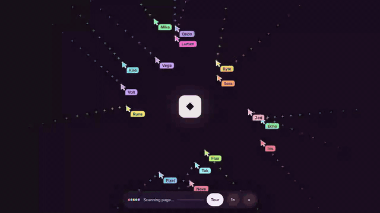

# 🏗️ Chantier en direct

*"Live construction site"*: **colored cursors** build your web page **right in front of you**, like a team working in a multiplayer design file.
Each cursor selects an element, types its text letter by letter, reveals the blocks, then moves on to the next one while the page scrolls down on its own.



▶️ [Watch the full video (35 s)](demo.mp4)


**Live demo:** https://ukiyoaj.github.io/chantier-en-direct/

## Features

- **16 named, colored cursors** (10 on mobile) with "+" trails
- **Scan phase**: the cursors circle a central logo before getting to work
- **Selection boxes** with a label and real dimensions (`titre · 323×25`)
- **Typed text**, letter by letter, without shifting the layout
- **Auto-scroll** that follows the build (it stops as soon as the visitor scrolls)
- **Control bar**: Tour (auto-scroll), 1× / 2× / 4× speed, build everything at once, replay
- Respects the system's **"Reduce motion"** setting: the page shows up finished, with a button to start the animation
- **No dependencies**: just one JS file and one CSS file to add
- If the script fails to load, the page simply displays normally

## Add it to your own site

**1. Copy** `css/chantier.css` and `js/chantier.js` into your project.

**2. Add them to your `<head>`** (the script must be in the head and **without** `defer`, so it can hide the blocks before the page is displayed):

```html
<link rel="stylesheet" href="css/chantier.css">
<script src="js/chantier.js" data-logo="aj"></script>
```

**3. Mark your elements:**

```html
<section data-frame data-l="hero">            <!-- area framed first -->
  <h1 class="b t" data-l="title">My name</h1>  <!-- text typed letter by letter -->
  <p class="b t">Some text.</p>
         <!-- block revealed left to right -->
  <div class="card b">                          <!-- a block can contain other blocks: -->
    <h3 class="b t">Project</h3>                <!-- they're built after it -->
  </div>
</section>
```

That's it: the engine finds the marked elements and builds them in page order.

| Marker | Effect |
|---|---|
| `class="b"` | block built by a cursor |
| `class="b t"` | text typed letter by letter (**plain text only**, no tags inside) |
| `data-frame` | area framed before being filled; its background appears at that moment |
| `data-l="name"` | name shown on the selection box label (defaults to the tag name) |

### Options

On the `<script>` tag:

| Attribute | Default | What it does |
|---|---|---|
| `data-logo` | first 2 letters of the page title | text of the central logo |
| `data-agents` | `16` (`10` on mobile) | number of cursors |
| `data-noms` | `Nova,Pixel,Byte,…` | cursor names, comma-separated |
| `data-auto` | `true` | `false` to not start automatically |

In JavaScript:

```js
Chantier.lancer();          // start (or restart) the build
Chantier.toutConstruire();  // show everything at once
```

In CSS, you can override `--chantier-hud`, `--chantier-texte`, `--chantier-encre` and `--chantier-duree`.
The cursor colors are in the `COULEURS` array at the top of `js/chantier.js`.

> The control bar text is in French ("Analyse de la page…", "Rejouer"…). You can translate it in `js/chantier.js`.

## Project structure

```
chantier-en-direct/
├── index.html          # demo page (a portfolio)
├── css/
│   ├── style.css       # demo page styles
│   └── chantier.css    # engine styles: cursors, boxes, control bar
├── js/
│   └── chantier.js     # the engine
├── demo.gif            # animation shown in this README
├── demo.mp4            # full demo video
├── apercu.png          # screenshot
├── LICENSE
└── README.md
```

## How it works

1. On load, the script lists every `.b` and `[data-frame]` element in page order: these are the "layers".
2. Each cursor takes the next free layer, preferring one that's visible on screen. A layer inside another one waits until its parent is built.
3. The cursor flies to the element (`getBoundingClientRect`), draws the selection box, then:
   - for text, splits it into two `span`s (typed part + transparent remainder) so nothing moves;
   - for a block, plays a CSS `clip-path` animation.
4. A `requestAnimationFrame` loop moves the cursors with exponential smoothing, draws the trails on a `<canvas>` and scrolls the page toward the area being built.

## Deploy with GitHub Pages

1. Push the repository to GitHub.
2. Go to **Settings → Pages**.
3. Under *Source*, pick the `main` branch and the `/ (root)` folder, then save.
4. The site is live at `https://<your-username>.github.io/chantier-en-direct/`.

## License

[MIT](LICENSE) © 2026 Amine Jebali ([@ukiyoaj](https://github.com/ukiyoaj)). You're free to use, modify and share it, as long as you keep the license notice.
